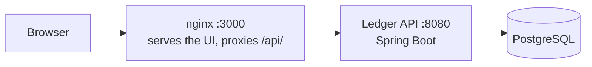
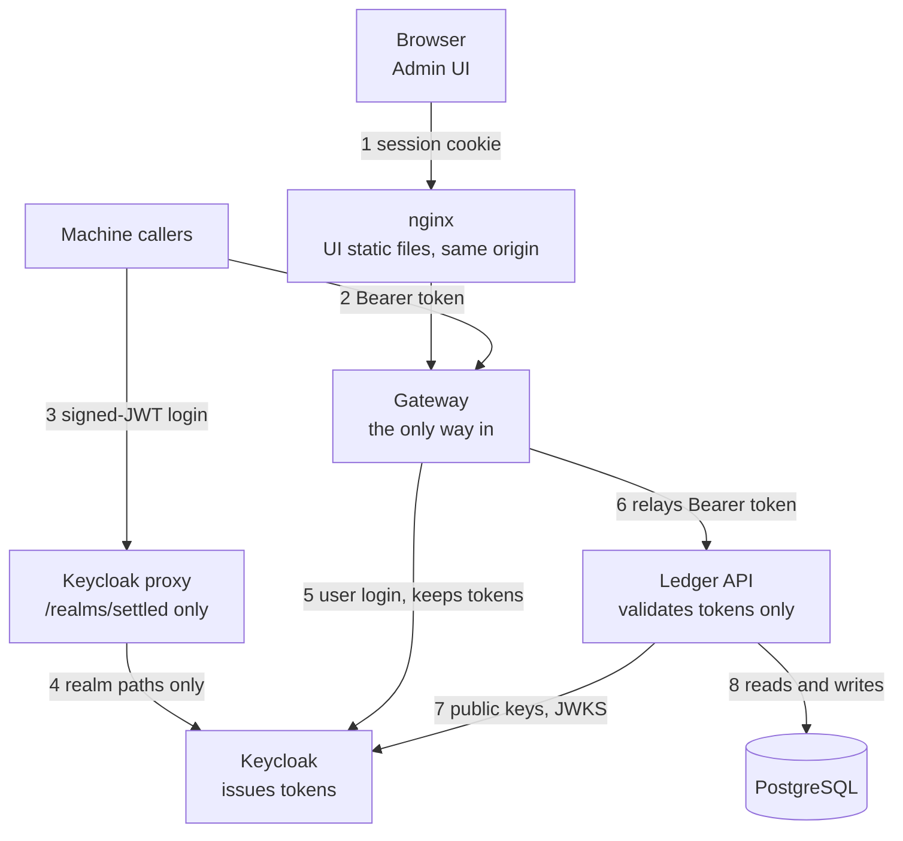

# Settled

A double-entry ledger as a service. Settled records transactions against accounts that already exist, keeps every transaction balanced (total debits equal total credits), and never deletes history.

**Status:** P0 (local development foundation) is complete. P1 (securing the ledger) has started: the authentication design is in [Architecture](#architecture), but none of it is built yet. Idempotent posting, reversals and everything after that are also ahead; see [What is not built yet](#what-is-not-built-yet).

---

## Stack

| Layer               | Technology                                                           |
| ------------------- | -------------------------------------------------------------------- |
| Backend             | Java 25, Spring Boot 4.1, Spring Data JPA, Flyway, springdoc-openapi |
| Database            | PostgreSQL (UUID primary keys, `NUMERIC(19,4)` money, `TIMESTAMPTZ`) |
| Frontend            | Vue 3.5, TypeScript 6.0, Vite 8, Pinia, Vue Router, Tailwind CSS 4   |
| Tests               | JUnit 5, Mockito, Testcontainers (PostgreSQL), Vitest                |
| Tooling             | Maven, Spotless (Palantir Java Format), JaCoCo, ESLint, Prettier     |
| Local orchestration | Docker Compose                                                       |

---

## Project structure

```
settled/
├── settled-backend/     Spring Boot service (controllers, services, repositories, Flyway migrations)
├── settled-ui/          Vue 3 single-page app, served by nginx in Docker
├── docker-compose.yaml  Local stack: postgres, redis, backend, frontend
├── .github/             CI workflow and issue/PR templates
├── LICENSE
└── README.md
```

---

## Architecture

Decisions behind this section are recorded in [docs/adr](docs/adr/README.md).

### Today (P0)



There is no authentication. Anyone who can reach the backend can call the API.

### Planned (P1): auth behind a single gateway

Designed, not built. See [ADR 0012](docs/adr/0012-authentication-and-authorization.md) (tokens and roles) and [ADR 0013](docs/adr/0013-edge-gateway-and-browser-sessions.md) (gateway and browser sessions).



| #   | What happens                                                                                  |
| --- | --------------------------------------------------------------------------------------------- |
| 1   | The browser holds only an `HttpOnly` session cookie. It never sees a token.                   |
| 2   | A machine caller sends its Bearer token to the gateway. The gateway passes it through.        |
| 3   | A machine caller gets its token from Keycloak with a signed JWT. There is no shared secret.   |
| 4   | The proxy exposes `/realms/settled` only. The admin console and management port stay private. |
| 5   | The gateway logs users in (authorization code) and keeps their tokens server-side.            |
| 6   | The gateway relays the Bearer token to the ledger.                                            |
| 7   | The ledger fetches Keycloak's public keys to verify token signatures.                         |
| 8   | The ledger reads and writes its data.                                                         |

**Principles**

- **We do not write authentication.** Keycloak is the issuer. The ledger is a resource server: it validates the JWT (signature, issuer, audience `settled-api`) and maps the role claim to `LEDGER_*` authorities. It has no login, no passwords and no sessions.
- **The gateway is the only way in** for every caller, human or machine. It holds no domain logic: routing, login and session only. Today it has one route, to the ledger. Extracted services later add routes.
- **The ledger always validates the token itself**, whoever sent it. The gateway is never the only check.
- **The token contract is what ties the pieces together.** Any issuer must provide `iss`, `aud` containing `settled-api`, a stable `sub`, and a role claim yielding `LEDGER_*` authorities. Access tokens last 10 minutes.
- **The issuer is swappable.** The same configuration keys are used in every profile and only the values change: `application-dev.yaml` holds the Keycloak values, and `application-gcp.yaml` is a keys-only placeholder. Moving human login to Google Identity Platform is a configuration change. Machine login would need a different mechanism, so the GCP issuer is not decided.
- **Direct access is closed.** The ledger is not reachable except through the gateway, enforced by network configuration.

---

## Quick start

### Prerequisites

- Docker with Docker Compose v2 (`docker compose`, with a space)
- Only if you run things outside Docker: Java 25, Maven 3.9+, Node.js 26

### 1. Create a `.env` file at the repository root

Compose reads these variables:

```bash
POSTGRES_DB=settled
POSTGRES_USER=postgres
POSTGRES_PASSWORD=change-me
POSTGRES_URL=jdbc:postgresql://postgres:5432/settled
REDIS_HOST=redis
REDIS_PORT=6379
```

The Postgres healthcheck in `docker-compose.yaml` is hard-coded to user `postgres` and database `settled`, so keep those two values as shown or the backend will never start.

### 2. Start the stack

```bash
docker compose up --build
```

| Service     | URL                                   |
| ----------- | ------------------------------------- |
| Frontend    | http://localhost:3000                 |
| Backend API | http://localhost:8080/api/v1          |
| Swagger UI  | http://localhost:8080/swagger-ui.html |
| Health      | http://localhost:8080/actuator/health |
| PostgreSQL  | localhost:5432                        |

The frontend's nginx proxies `/api/` to the backend, so the browser only talks to port 3000.

Flyway applies the migrations in `settled-backend/src/main/resources/db/migration` on startup. To wipe the database and start clean:

```bash
docker compose down -v
```

---

## How a transaction works

A transaction is built up in steps, the way accounting systems do it, and is locked once posted.

1. **Create** a transaction. It starts in `DRAFT`.
2. **Add postings** one at a time. Each posting is a `DEBIT` or `CREDIT` of an amount against an account.
3. **Post** the transaction. This succeeds only if it is in `DRAFT`, has at least one posting, and total debits equal total credits. A posted transaction can no longer take postings.

Nothing is deleted. Statuses are `DRAFT`, `POSTED` and `REVERSED`.

```bash
# 1. Create two accounts
curl -X POST localhost:8080/api/v1/accounts -H 'Content-Type: application/json' \
  -d '{"code":"CHK001","name":"Main Checking","type":"CHECKING"}'
curl -X POST localhost:8080/api/v1/accounts -H 'Content-Type: application/json' \
  -d '{"code":"SAV001","name":"Savings","type":"SAVINGS"}'

# 2. Create a draft transaction
curl -X POST localhost:8080/api/v1/transactions -H 'Content-Type: application/json' \
  -d '{"reference":"TXN-001","description":"Move to savings","postedAt":"2026-11-03T10:00:00.000Z"}'

# 3. Add a debit and a credit (use the ids returned above)
curl -X POST localhost:8080/api/v1/transactions/<txn-id>/postings -H 'Content-Type: application/json' \
  -d '{"accountId":"<chk-id>","amount":"100.00","direction":"DEBIT"}'
curl -X POST localhost:8080/api/v1/transactions/<txn-id>/postings -H 'Content-Type: application/json' \
  -d '{"accountId":"<sav-id>","amount":"100.00","direction":"CREDIT"}'

# 4. Post it
curl -X POST localhost:8080/api/v1/transactions/<txn-id>/post
```

### Endpoints

| Method | Path                                 | Purpose                                            |
| ------ | ------------------------------------ | -------------------------------------------------- |
| POST   | `/api/v1/accounts`                   | Create an account                                  |
| GET    | `/api/v1/accounts`                   | List accounts, optional `?status=ACTIVE\|ARCHIVED` |
| GET    | `/api/v1/accounts/{id}`              | Get an account by id                               |
| GET    | `/api/v1/accounts/code/{code}`       | Get an account by code                             |
| PUT    | `/api/v1/accounts/{id}/archive`      | Archive an account                                 |
| POST   | `/api/v1/transactions`               | Create a draft transaction                         |
| GET    | `/api/v1/transactions`               | List transactions, optional `?status=`             |
| GET    | `/api/v1/transactions/{id}`          | Get a transaction                                  |
| POST   | `/api/v1/transactions/{id}/postings` | Add a posting to a draft transaction               |
| POST   | `/api/v1/transactions/{id}/post`     | Post a balanced draft transaction                  |

Request and response schemas, and per-endpoint status codes, are in Swagger UI.

### Response format

Every response uses the same envelope.

```json
{
  "status": "SUCCESS",
  "code": 201,
  "timestamp": "2026-11-03T10:00:00.123Z",
  "requestId": "…",
  "data": {}
}
```

Errors carry a machine-readable `errorCode` and a human-readable `message`; validation errors also list each failing field.

```json
{
  "status": "ERROR",
  "code": 409,
  "timestamp": "2026-11-03T10:00:00.123Z",
  "requestId": "…",
  "error": {
    "errorCode": "ACC_003",
    "message": "Account code already exists",
    "details": "…",
    "field": "code"
  }
}
```

Money amounts are sent and returned as JSON strings (`"100.00"`), never numbers, so no client ever rounds them through a float. Timestamps are UTC ISO-8601.

---

## Development

### Backend

```bash
cd settled-backend
mvn test              # unit + integration tests (needs Docker for Testcontainers)
mvn spotless:apply    # format code
mvn verify            # tests, Spotless check, JaCoCo coverage gate (90% line coverage)
```

Integration tests run against a real PostgreSQL container with the real Flyway migrations; there is no in-memory database in the test path.

### Frontend

```bash
cd settled-ui
npm ci
npm run dev           # Vite dev server
npm run test:run      # Vitest
npm run lint
npm run format:check
npm run build         # type-check + production build
```

---

## What is not built yet

- Authentication and authorization, including the gateway and the Keycloak setup. The design is in [Architecture](#architecture) and ADRs 0012 and 0013.
- Idempotent posting. The `idempotency_keys` table exists, but nothing reads or writes it yet.
- Reversals of posted transactions
- Account balances and per-account ledger views
- Redis. The container is provisioned in Compose, but the backend does not use it yet.
- Cloud deployment. GCP is the target.

---

## License

GNU General Public License v3. See [LICENSE](LICENSE).
